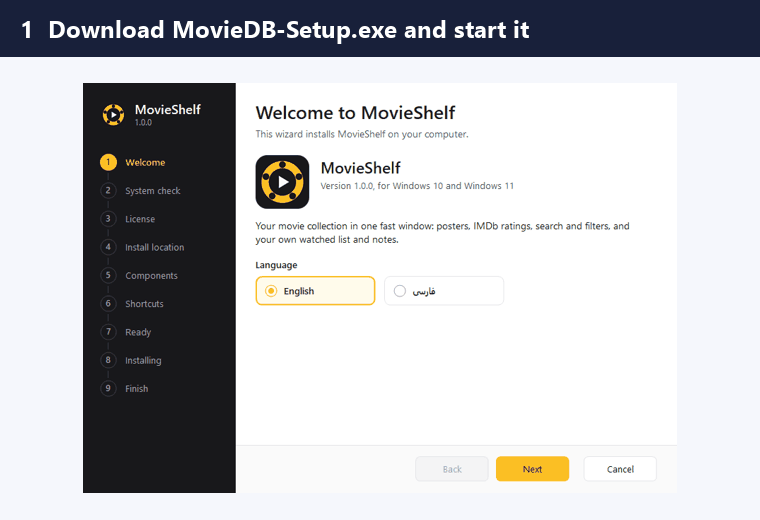
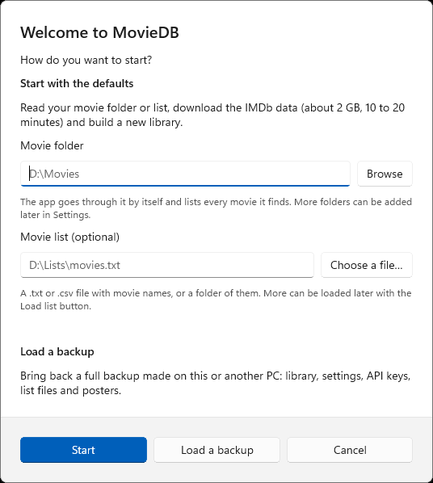
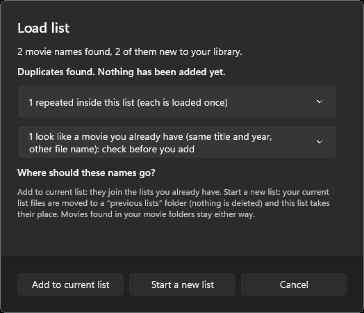
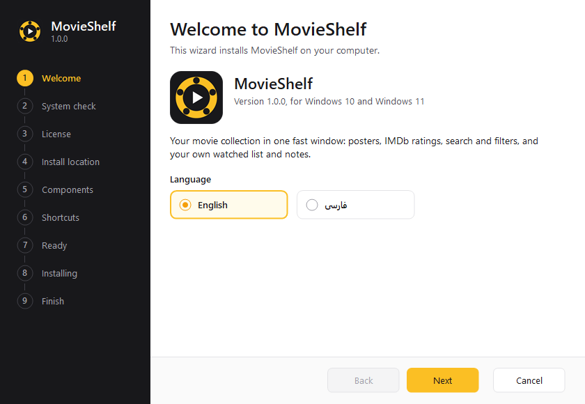
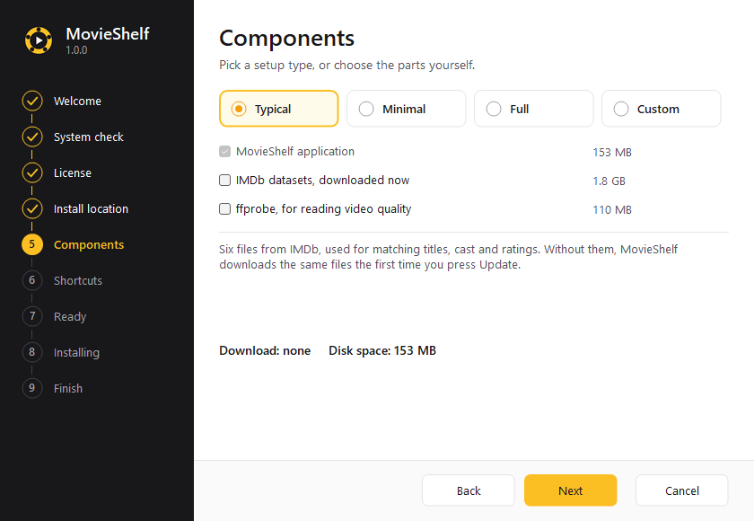

<div align="center">


# 🎬 MovieShelf

### Your whole movie collection in one fast, offline window.

Posters ⭐ IMDb ratings 🔎 instant search 🧹 duplicate and quality checks 🗂️ collections 🌍 English + فارسی

[](https://github.com/hamednikseresht/MovieShelf/releases/latest)
[](https://github.com/hamednikseresht/MovieShelf/releases)
[](LICENSE)


**[⬇️ Download for Windows](https://github.com/hamednikseresht/MovieShelf/releases/latest)** ·
**[🐍 macOS / Linux guide](docs/PYTHON-OTHER-PLATFORMS.md)** ·
**[📖 Full guide](docs/GUIDE.md)** ·
**[💬 Ask a question](https://github.com/hamednikseresht/MovieShelf/issues)**



</div>

---

## ✨ What is MovieShelf?

You have a pile of movie files (or just a list of names). MovieShelf turns them into a **beautiful, searchable library** with posters, ratings, cast, quality info and more. It works **offline** after the first update, keeps your data **on your own PC**, and never renames or deletes your files.

> 🧠 **How it finds your movies:** point it at a **movie folder**, or **load a list** (a `.txt` or `.csv` with one name per line), or both. It matches every name against the IMDb dataset on your computer.

## 🚀 Pick your version

| | 🪟 **Windows app** (recommended) | 🐍 **Python app** (any platform) |
|---|---|---|
| **For** | Windows 10 (1809+) and Windows 11, 64-bit | Windows, macOS, Linux |
| **Install** | One setup file, a wizard, uninstaller included | `./run.sh` (macOS / Linux) or `Setup.bat` (Windows) |
| **Needs** | Nothing else | Python 3.9 or newer (set up for you) |
| **Look** | Native WinUI 3 window, very fast | Web page in its own window or your browser |
| **Same library?** | ✅ Both read the same data format | ✅ |
| **Get it** | [**MovieShelf-Setup-1.0.0.exe**](https://github.com/hamednikseresht/MovieShelf/releases/latest) | [**MovieShelf-Python-1.0.0.zip**](https://github.com/hamednikseresht/MovieShelf/releases/latest) or clone this repo |

## 🪟 Windows: install in 3 steps

1. ⬇️ Download **`MovieShelf-Setup-1.0.0.exe`** from the [latest release](https://github.com/hamednikseresht/MovieShelf/releases/latest).
2. ▶️ Run it and follow the wizard (English or فارسی). Windows may show a blue *SmartScreen* box: choose **More info → Run anyway** (the app is not code-signed, see [Security](#-security-and-privacy)).
3. 🎉 Start **MovieShelf** from the Start menu. On the first start, give it your **movie folder** and/or a **list file**, press **Start**, and wait 10 to 20 minutes while it downloads the IMDb data (about 2 GB, once).

📘 Step by step with pictures: [docs/INSTALL-WINDOWS.md](docs/INSTALL-WINDOWS.md)

<details>
<summary>🤫 Silent install (for IT or scripts)</summary>

```bat
MovieShelf-Setup-1.0.0.exe /S /D=C:\Tools /NODESKTOP
"C:\Tools\MovieShelf\uninstall.exe" /S
```
All options: [docs/INSTALL-WINDOWS.md](docs/INSTALL-WINDOWS.md#-silent-install).
</details>

## 🍎🐧 macOS and Linux: run the Python app

```bash
git clone https://github.com/hamednikseresht/MovieShelf.git
cd MovieShelf
chmod +x run.sh
./run.sh
```

The first run creates a private Python environment (no changes to your system Python) and opens MovieShelf in your browser. Full guide and troubleshooting: [docs/PYTHON-OTHER-PLATFORMS.md](docs/PYTHON-OTHER-PLATFORMS.md).

> ⚠️ I develop and test on Windows. The macOS and Linux scripts are written carefully but have had less testing, so please [open an issue](https://github.com/hamednikseresht/MovieShelf/issues) if something does not work.

## 🧰 Features

### 📚 Your library
- 🖼️ **Poster grid or table**, sorted by title, year, IMDb rating, votes, Rotten Tomatoes, Metacritic, runtime, date added, or your own stars
- 🎞️ **Movie window:** plot, tagline, directors, cast (click a name for a **person profile**), every file with its quality
- ⭐ **Favorite, Watched, your own rating and notes** on every movie
- 📺 **Series** have their own section
- 🧑‍🎤 **People profiles** with photo, bio and filmography (TMDB)

### 🔎 Find anything, fast
- 🧠 **Search language:** `year:1990-1999 rating:>8 genre:comedy dir:nolan actor:pitt res:4k is:unwatched has:poster -horror "exact phrase"`
- 🎚️ **Filters** for status, genre, decade, rating, votes, resolution, source, audio, country, language
- 💾 **Saved views**, group-by, and **Watch next** suggestions

### 📥 Getting movies in
- 📁 **Movie folders:** every movie in them is listed and goes away when its video does
- 📝 **Load list:** a `.txt` or `.csv` list, a folder of lists, or a folder of movies. You see **repeated, existing and similar names first**, then **add to the current list** or **start a new one** (old lists are moved aside, nothing is deleted)
- 🔍 **Check a list:** compare a list against your library: new, better, worse or already there

### 🧹 Keep it clean
- 🚩 **Problems window:** wrong matches, **duplicates**, low quality, name differs, year differs, no poster, empty folders, dubbed only, with one-click **Fix match**
- ✏️ **Rename plan:** write a tidy-name script for your files, subtitles and folders with your own pattern, for example `{title} ({year}) [{res} {src}]`. MovieShelf never renames anything itself: you read the script and run it
- 🎯 **ffprobe** support reads real resolution, codec, audio and subtitle languages

### 🗂️ Collections and extras
- 🧩 **Collections:** what you own and what is missing from each franchise
- 🎁 **Wishlist** and 📊 **Statistics** (click a bar to filter)
- 📤 **Export** to Excel (`.xlsx`) or CSV with the columns you choose
- 💾 **Backups:** a quick personal backup every day, plus full `.zip` backups to move to another PC
- 🌍 **English and Persian (فارسی)** with full right-to-left layout, light and dark themes

## 📸 Screenshots

| First start | Load list |
|:--:|:--:|
|  |  |
| **Install wizard** | **Install options** |
|  |  |

## ❓ Quick answers

<details>
<summary>🌐 Does it need the internet?</summary>

Only to **download the IMDb data once** (about 2 GB), to refresh ratings weekly, and to fetch posters. After that browsing, searching and filtering work **offline**.
</details>

<details>
<summary>🔑 Do I need API keys?</summary>

No. **TMDB** and **OMDb** keys are optional (Settings). Without them you still get IMDb data, posters and Wikidata scores.
</details>

<details>
<summary>🗑️ Will it touch my movie files?</summary>

**Never.** It only reads folders. The rename plan writes a script you read and run yourself.
</details>

<details>
<summary>📦 Where is my data?</summary>

Windows: `%LOCALAPPDATA%\MovieShelf`. macOS and Linux: see the [Python guide](docs/PYTHON-OTHER-PLATFORMS.md#where-your-data-lives). Uninstalling asks what to keep, and keeps your library by default.
</details>

<details>
<summary>🔁 I used the old name "MovieDB". Is my library safe?</summary>

MovieShelf is the new name of MovieDB. Rename your old folder `%LOCALAPPDATA%\MovieDB` to `MovieShelf` and your library, settings and backups carry over. Old full backups (`.zip`) restore fine.
</details>

<details>
<summary>🛟 Something went wrong</summary>

Check the **Troubleshooting** topic in the app's Help (the **?** button), or [open an issue](https://github.com/hamednikseresht/MovieShelf/issues/new/choose) with the log from `%LOCALAPPDATA%\MovieShelf\data\`.
</details>

## 📚 Documentation

| 📖 Guide | What is inside |
|---|---|
| [**docs/GUIDE.md**](docs/GUIDE.md) | The complete user guide: search, problems, collections, backup, export, files |
| [**docs/INSTALL-WINDOWS.md**](docs/INSTALL-WINDOWS.md) | Windows install with pictures, silent install, uninstall, fixes |
| [**docs/PYTHON-OTHER-PLATFORMS.md**](docs/PYTHON-OTHER-PLATFORMS.md) | Run MovieShelf on macOS, Linux or Windows with Python |
| [**docs/BUILD.md**](docs/BUILD.md) | Build the Windows app and the setup file yourself, run the tests |
| [**CHANGELOG.md**](CHANGELOG.md) | What changed in each release |

The app also has its own **Help** (the **?** button) in English and Persian.

## 🗺️ Repository map

```
MovieShelf/
├─ app/            🐍 Python app (server + web pages): macOS, Linux, Windows
├─ native/         🪟 Windows app (C#, .NET 10, WinUI 3) and its setup wizard
│  ├─ MovieShelf.Core/        engine: matcher, IMDb index, backups, export, search
│  ├─ MovieShelf.App/         the windows and dialogs
│  ├─ MovieShelf.Core.Tests/  256 tests, including parity checks against the Python app
│  └─ Installer/              the one-file setup and uninstall wizard
├─ docs/           📖 guides and images
├─ tests/          ✅ Python and search tests
├─ run.sh          ▶️ start on macOS / Linux
└─ Setup.bat       ▶️ set up and start the Python app on Windows
```

## 🔒 Security and privacy

- 🏠 Your library never leaves your PC. MovieShelf talks to IMDb (dataset downloads), TMDB / OMDb (only if you add a key), Wikidata and poster hosts.
- 🔑 API keys are stored in your own settings file, never sent anywhere else.
- 🛡️ The Windows setup is **not code-signed** (signing costs money), so *SmartScreen* may warn. Check the file with the `SHA256SUMS.txt` published on each release, or [build it yourself](docs/BUILD.md).

## 🤝 Contributing

Bug reports, ideas, translations and pull requests are welcome. See [CONTRIBUTING.md](CONTRIBUTING.md).

## 🙏 Credits and data

- 🎥 Ratings and titles come from the **IMDb non-commercial datasets**. This is a personal-use tool, see [IMDb's terms](https://developer.imdb.com/non-commercial-datasets/).
- 🌐 Extra details and photos: [TMDB](https://www.themoviedb.org/) (*this product uses the TMDB API but is not endorsed or certified by TMDB*), [OMDb](https://www.omdbapi.com/), [Wikidata](https://www.wikidata.org/).
- 🔤 Fuzzy matching: [RapidFuzz](https://github.com/rapidfuzz/RapidFuzz). Windows UI: [Windows App SDK](https://github.com/microsoft/WindowsAppSDK). Own window in Python: [pywebview](https://github.com/r0x0r/pywebview).

## 📄 License

[MIT](LICENSE) © 2026 Hamed Nikseresht

<div align="center">

⭐ **If MovieShelf helps you, give it a star. It makes my day!** ⭐

</div>
