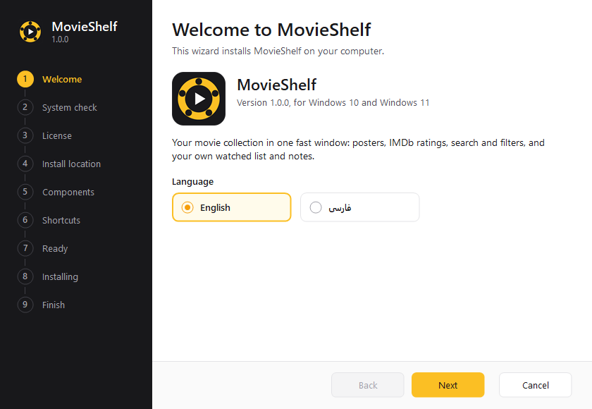
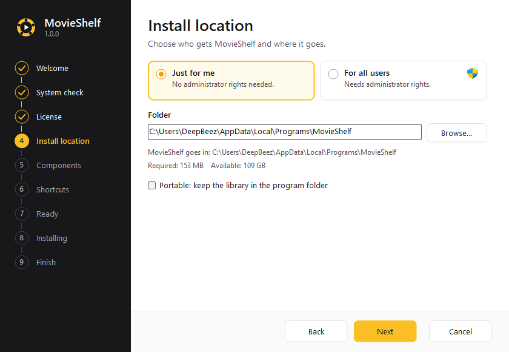
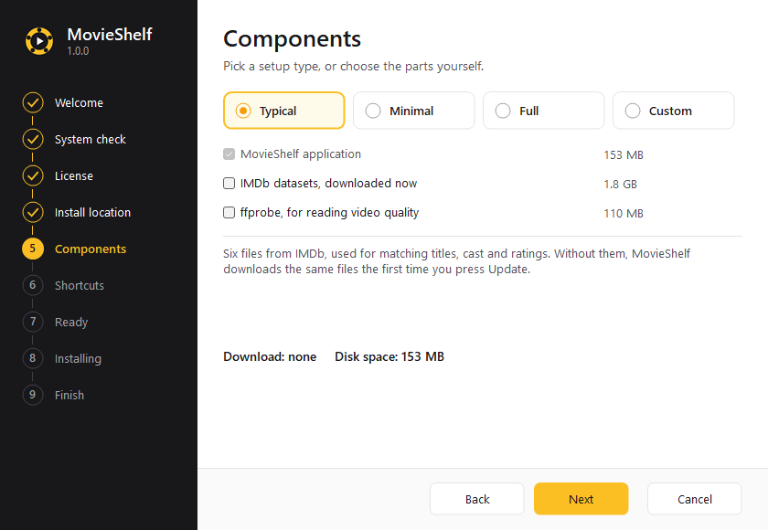
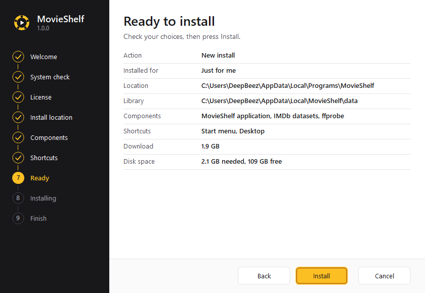
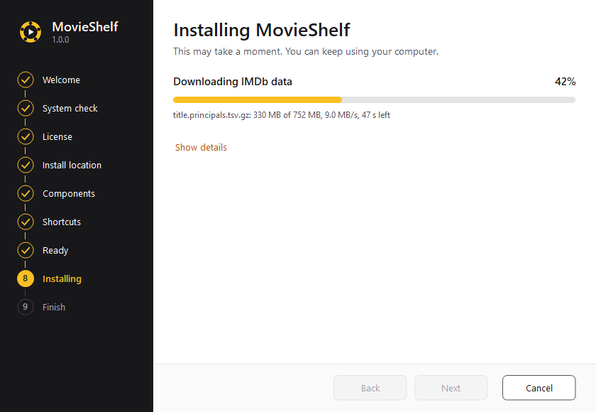
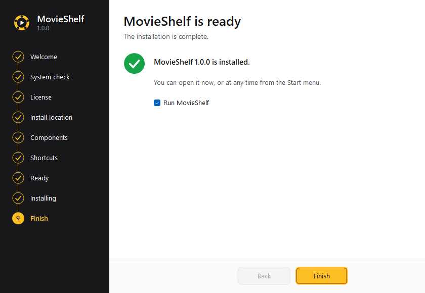
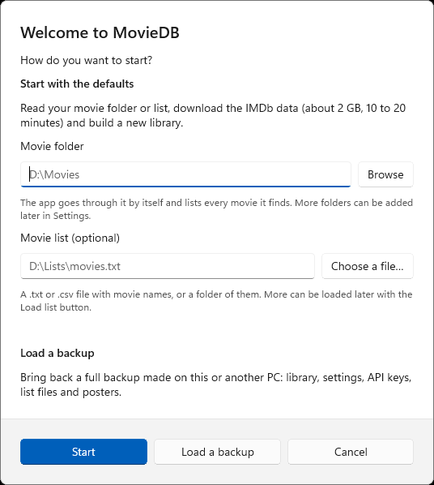
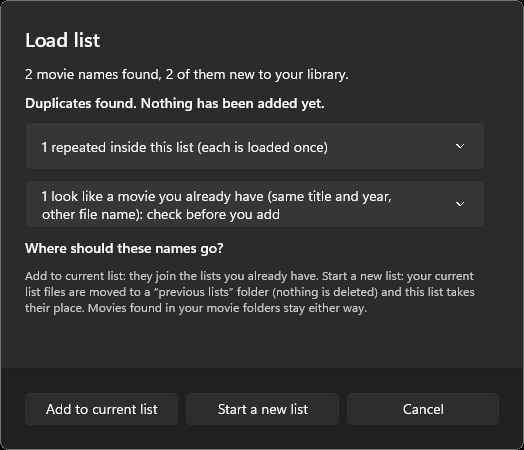

# 🪟 Install MovieShelf on Windows

> ✅ Windows 10 (version 1809 or newer) and Windows 11, 64-bit. Nothing else needs to be installed first.
> 💾 About **250 MB** for the program, plus about **3 GB** for the IMDb data (optional at setup, otherwise downloaded on the first start). Keep about 4 GB free.

## 🧭 Step by step

### 1️⃣ Download

Get **`MovieShelf-Setup-1.0.0.exe`** from the [latest release](https://github.com/hamednikseresht/MovieShelf/releases/latest) (about 39 MB).

🔐 *Optional check:* compare the file's SHA-256 with `SHA256SUMS.txt` on the release page:

```powershell
Get-FileHash .\MovieShelf-Setup-1.0.0.exe -Algorithm SHA256
```

### 2️⃣ Run it

Double-click the file. If Windows shows **"Windows protected your PC"** (SmartScreen), choose **More info → Run anyway**. This happens because the file is not code-signed.

| | |
|---|---|
|  | **Welcome.** Pick English or فارسی. The wizard (and the app) switch to right-to-left for Persian. |
|  | **Install location.** *Just for me* needs no administrator rights. *For all users* asks for it. *Portable* keeps the library next to the program. |
|  | **Components.** Tick **IMDb data** to download it now (about 1.9 GB), or leave it and it downloads on the first start. **ffprobe** reads real video details (optional). |
|  | **Ready.** Check the summary and press **Install**. |
|  | **Installing.** Safe to cancel: everything is rolled back. |
|  | **Finish.** Tick *Start MovieShelf* and you are done. |

### 3️⃣ First start



1. Choose how to begin:
   - 📁 **Movie folder:** where your movies are. MovieShelf finds every movie in it.
   - 📝 **Movie list (optional):** a `.txt` or `.csv` with movie names (one per line), or a folder of them.
   - One of the two is enough. Add more later in **Settings** (folders) or with **Load list**.
2. Press **Start**. MovieShelf downloads the IMDb data (about 2 GB, **once**), matches your movies, and gets posters, cast and scores. Plan for **10 to 20 minutes**. A progress bar shows the work, and you can close the app: finished parts are kept.
3. Already have a **full backup** from another PC? Choose **Load a backup** instead.

<br clear="right">

### 4️⃣ Add more movies later

- 📁 **Settings → Movie folders:** one folder per line. It saves when you leave the box and is read at once.
- 📝 **Load list** (top bar): pick a file or folder, see the duplicates, then **Add to current list** or **Start a new list**.



## 🔄 Update, repair, uninstall

Run a newer setup file over the old one: it offers **Upgrade or repair** and keeps your library and choices. To remove MovieShelf use **Settings → Apps → Installed apps → MovieShelf → Uninstall** (or run `uninstall.exe` in the install folder). It asks what to keep, and keeps your **library** unless you untick it.

## 🤫 Silent install

```bat
MovieShelf-Setup-1.0.0.exe /S [/D=path] [/ALLUSERS] [/COMPONENTS=imdb,ffprobe] [/DESKTOP] [/NODESKTOP] [/NOSTARTMENU] [/PORTABLE] [/RUN] [/LANG=fa] [/LOG=path]
uninstall.exe /S [/DELETEDATA=library,backups,settings,posters,imdb,all] [/LOG=path]
```

- `/D=C:\Tools` installs into **`C:\Tools\MovieShelf`** (the wizard adds the `MovieShelf` folder).
- `-y` means the same as `/S`.
- Exit codes: `0` done, `1` failed, `2` bad arguments, `3` cancelled, `4` Windows too old, `5` damaged setup file, `6` done but an optional download failed, `1223` administrator prompt declined.

## 🛠️ Troubleshooting

| Problem | Fix |
|---|---|
| SmartScreen blocks the file | **More info → Run anyway**, or build it yourself: [BUILD.md](BUILD.md) |
| "This version of Windows is not supported" | Needs Windows 10 version 1809 or newer, 64-bit |
| The IMDb download stops | Press **Start** or **Update** again. Downloads resume where they stopped |
| Posters are missing | Open **Problems → Other → No poster** and press **Retry missing posters** |
| `ffprobe not found` | Re-run setup and tick **ffprobe**, or `winget install Gyan.FFmpeg`, then restart |
| Nothing found in my folder | Check the path in **Settings → Movie folders**. Network drives must be connected |
| Where are the logs? | `%LOCALAPPDATA%\MovieShelf\data\` (`native.log`, `install.log` is in the install folder) |

Still stuck? [Open an issue](https://github.com/hamednikseresht/MovieShelf/issues/new/choose) and attach the log. Please remove anything private first.

## 📂 Where things are

| What | Where |
|---|---|
| Program | `%LOCALAPPDATA%\Programs\MovieShelf` (just for me) or `C:\Program Files\MovieShelf` (all users) |
| Library, posters, settings, IMDb data, backups | `%LOCALAPPDATA%\MovieShelf` |
| Your movie lists (default) | `Documents\MovieShelf\lists` |
